<div align="center">
  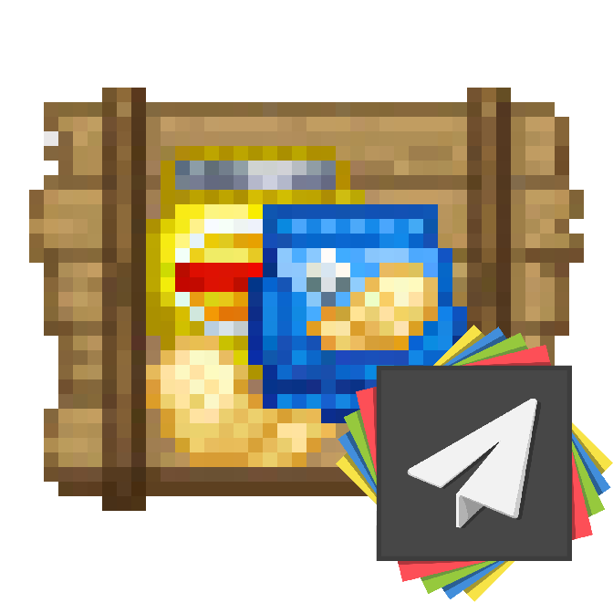
  <h1>SyalsDelight-CE</h1>
  <p>A Paper/Folia server port powered by CraftEngine and FarmersDelight.</p>
</div>

<p align="center">
  <a href="#environment-and-installation"></a>
  <a href="https://github.com/Xiao-MoMi/craft-engine"></a>
  <a href="https://github.com/IOVEYOUMC0/Farmersdelight-Plugin"></a>
  <a href="#environment-and-installation"></a>
  <a href="#environment-and-installation"></a>
  <a href="#environment-and-installation"></a>
</p>

## About

SyalsDelight ports the main gameplay of
[syals-delight](https://github.com/y271727uy/syals-delight) to a CraftEngine-powered
Paper/Folia server plugin. It is an add-on for
[FarmersDelight](https://github.com/IOVEYOUMC0/Farmersdelight-Plugin) and includes
custom food, a potato processing chain, flavored chips, oil bottles, animal-fat
drops, a peeler, and public cooking-pot and cutting-board recipe pages.

The port baseline is the upstream `main` branch, mod version `1.20.1-1.0.2`.

## Implemented

- All 30 items actually registered by the upstream source.
- 22 edible items and the complete process from potatoes to finished chips.
- Three oil bottles that return a glass bottle when consumed by a recipe.
- 9 public cooking-pot recipes, 2 public cutting-board recipes, and 18
  CraftEngine workbench recipes.
- Seven animal-fat extra drops implemented with `EntityDeathEvent`.
- Complete Simplified Chinese and English item and category translations.
- 30 item models, 30 textures, and animated metadata for `naquadah_chips`.
- A CraftEngine resource installer with a version marker, missing-file repair,
  and stale-file cleanup.
- bStats analytics through plugin ID `35133`.
- Folia-safe event handling without `BukkitScheduler` or cross-region mutable
  gameplay state.

## Items and Acquisition

| Item | Obtaining | Item | Obtaining |
|---|---|---|---|
| <br><small>Syals</small> | Crafting table, shapeless: 4 batch-fried slices + Syal's bag | <br><small>Bag O' Chips</small> | Crafting table, shapeless: 4 greasy slices + chips bag |
| <br><small>Kettle Chips</small> | Crafting table, shapeless: 4 hot slices + chips bag | <br><small>Naquadah Chips</small> | Crafting table, shapeless: 4 fried naquadah slices + chips bag |
| 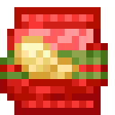<br><small>Reduced Fat Chips</small> | Crafting table, shapeless: 4 low-fat slices + raw salmon + chips bag | <br><small>Vinegar Chips</small> | Crafting table, shapeless: source vinegar or fallback honey bottle + 4 fried slices |
| 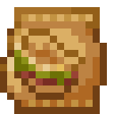<br><small>Donkey Burger Chips</small> | Crafting table, shapeless: source donkey burger or fallback cooked beef + 4 fried slices | 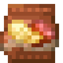<br><small>Smoker Ham Chips</small> | Crafting table, shapeless: FarmersDelight smoked ham + 4 fried slices |
| 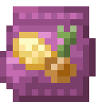<br><small>Onion Chips</small> | Crafting table, shapeless: FarmersDelight onion + 4 fried slices | 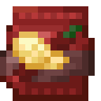<br><small>Spicy Chips</small> | Crafting table, shapeless: 2 blaze powder + 4 fried slices |
| <br><small>Tomato Chips</small> | Crafting table, shapeless: FarmersDelight tomato + 4 fried slices | 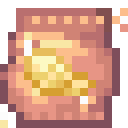<br><small>Astera Chips</small> | Crafting table, shapeless: source star dust or fallback amethyst shard + 4 fried slices |
| <br><small>Broccoli Flavored Slimming Chips</small> | Crafting table, shapeless: FarmersDelight cabbage + 4 low-fat slices | <br><small>Pesto Flavored Chips</small> | Crafting table, shapeless: FarmersDelight tomato sauce + 4 fried slices |
| 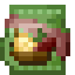<br><small>Steak Chimichurri Chips</small> | Crafting table, shapeless: tomato sauce + cooked beef + 4 fried slices | 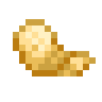<br><small>Batch Fried Potato Slice</small> | Cooking pot: 4 potato slices + 2 food oil |
| 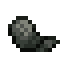<br><small>Fried Naquadah Potato Slice</small> | Cooking pot: potato slices, food oil, and the fallback crystal | <br><small>Fried Potato Slice</small> | Cooking pot: 2 potato slices + 2 food oil |
| 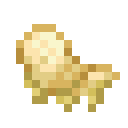<br><small>Greasy Potato Slice</small> | Cooking pot: 2 potato slices + 3 food oil | 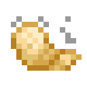<br><small>Hot Potato Slice</small> | Cooking pot: 2 fried slices + 2 food oil |
| 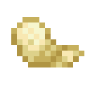<br><small>Low Fat Potato Slice</small> | Cooking pot: 2 potato slices + 1 food oil | <br><small>Potato Slice</small> | Cutting board: peeled potato + FarmersDelight knife |
| <br><small>Chips Bag</small> | Crafting table, shaped: 4 paper | <br><small>Syal's Chips Bag</small> | Crafting table, shapeless: chips bag + yellow dye + red dye |
| 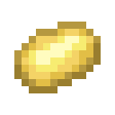<br><small>Peeled Potato</small> | Cutting board: potato + exact `syals_delight:peeler` | <br><small>Animal Fat</small> | Death of a cow, pig, sheep, chicken, rabbit, goat, or mooshroom |
| 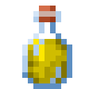<br><small>Oil Bottle</small> | Cooking pot: 2 animal fat | 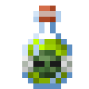<br><small>Zombie Oil Bottle</small> | Cooking-pot fallback: 2 rotten flesh |
| 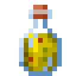<br><small>Underground Oil Bottle</small> | Cooking-pot fallback: 2 coal | <br><small>Peeler</small> | Crafting table, shaped: iron ingot + stick |

## Food Values

The 1.20.1 Forge `FoodProperties` API uses a saturation modifier, while
CraftEngine uses an absolute saturation value. This project uses the following
conversion:

```text
CraftEngine absolute saturation = hunger value × source saturationModifier × 2
```

| Category | Hunger | Source modifier | CraftEngine saturation |
|---|---:|---:|---:|
| Standard chips | 6 | 9.3 | 111.6 |
| Reduced-fat chips | 4 | 8.6 | 68.8 |
| Vinegar chips | 6 | 9.9 | 118.8 |
| Naquadah chips | 189 | 66.4 | 25099.2 |
| Chip intermediates | 2 | 2.0 | 8.0 |

The source registers no potion effects for any food, so this project does not
add effects that did not exist upstream.

## Peeler

The upstream peeler is a stone-tier sword with construction parameters of 3
attack damage and -2.4 attack speed. Stone tier adds 1 more attribute damage,
so it matches a stone sword's final 5 damage. This project preserves that final
damage, 131 durability, and attack speed. The peeler is not added to the
FarmersDelight knife tag; only the `minecraft:potato -> peeled_potato` cutting
board recipe accepts the exact peeler ID.

## Recipes and Tags

The upstream source contains 37 recipe JSON files, 17 of which reference
optional-mod namespaces and are therefore not registered directly. The project
uses 10 separate fallback recipes to restore acquisition paths. The runtime pack
contains:

| Station | Count | Category |
|---|---:|---|
| FarmersDelight cooking pot | 9 | public `cooking_pot` |
| FarmersDelight cutting board | 2 | public `cutting_board` |
| CraftEngine workbench | 18 | CraftEngine recipe book |

The project does not create a private `RecipeType`. Potato slicing uses
`#farmersdelight:tools/knives`; `syals_delight:food_oil` contains only the three
oil bottles.

## Animal Fat Drops

The original mod appends one animal fat to the death loot of cows, pigs, sheep,
chickens, rabbits, goats, and mooshrooms without a probability check. This
project preserves a 100% chance and amount 1 by default. `config.yml` can change
the chance, amount, and entity list.

Drops are synchronously added to `EntityDeathEvent` on the region thread, so
Folia compatibility is preserved. The plugin only accepts the exact ID
`syals_delight:animal_fat`; if CraftEngine returns AIR, BARRIER, or another
custom ID, the extra drop is cancelled.

## Currently No Compatibility Projects

There are currently no compatibility projects for the optional-mod namespaces
referenced by the source. Original recipes that depend on those items are not
registered; fallback recipes are used uniformly to keep every add-on item
obtainable.

| Namespace | Source item | Use |
|---|---|---|
| `gtceu` | 5 naquadah dust types | Fried naquadah slice |
| `mekanism_extras` | `dust_naquadah` | Fried naquadah slice |
| `ltc2` | `solid_underground_oil` | Underground oil bottle |
| `unusualfoodsdelight` | `zombie_oil_block` | Zombie oil bottle |
| `vintagedelight` | `vinegar_bottle` | Vinegar chips |
| `manors_bounty` | `rice_vinegar` | Vinegar chips |
| `dumplings_delight` | `vinegar` | Vinegar chips |
| `smc` | `star_dust`, `broccoli` | Astera and broccoli chips |
| `kaleidoscope_cookery` | `donkey_burger`, `oil` | Donkey burger chips and animal fat to oil |
| `cosmopolitan` | `green_sauce` | Pesto and steak chimichurri chips |

Acquisition categories:

- Directly obtainable with only Minecraft, CraftEngine, and FarmersDelight:
  all 30 add-on items.
- Original recipes that require an additional compatibility provider: fried
  naquadah slice, underground oil, zombie oil, vinegar chips, astera chips,
  broccoli chips, donkey burger chips, pesto chips, and steak chimichurri chips.
- Currently unavailable as original external items: the 16 IDs in the table
  above.

Fallback recipes are located in
`configuration/compatibility_fallback_recipes.yml` and
`configuration/farmersdelight/compatibility_fallback_recipes.yml`. They never
write unknown namespaces into the running CraftEngine recipes.

## Environment and Installation

1. Install Java 21 and Paper 26.3 or Folia 26.3.
2. Install CraftEngine 26.9.1 or newer.
3. Install FarmersDelight-Plugin 1.0.3.
4. Place `SyalsDelight-1.0.0.jar` in `plugins/`.
5. Fully stop and restart the server.

The first start installs `plugins/CraftEngine/resources/syals_delight` and
writes `.syals-delight-resources-version`. Normal restarts only restore missing
files. A plugin version change replaces the owned namespace and removes files
that are no longer included. Existing user changes to external `config.yml`,
`gui.yml`, and `lang/*.yml` files are never overwritten.

## Configuration

`config.yml` controls the player-message language, resource repair, version
replacement, animal-fat enablement/chance/amount/entity list, and optional-item
checking after FarmersDelight warmup.

`gui.yml` only records the use of FarmersDelight's public recipe pages. This
add-on has no private station GUI.

## License

The upstream Syal's Delight mod is licensed under the MIT License. This
SyalsDelight Paper/Folia plugin is licensed under the GNU Affero General Public
License, version 3 (AGPL-3.0-only).

## Sponsorship

If this project helps you, you can support development through Ko-fi or Afdian.
Sponsors can request plugin installation, configuration, and troubleshooting
question-and-answer support.

<div align="center">
  <a href="https://ko-fi.com/J5C529ZWWL" target="_blank"></a>
  <a href="https://afdian.com/a/sss000" target="_blank"></a>
</div>
