<div align="center">
  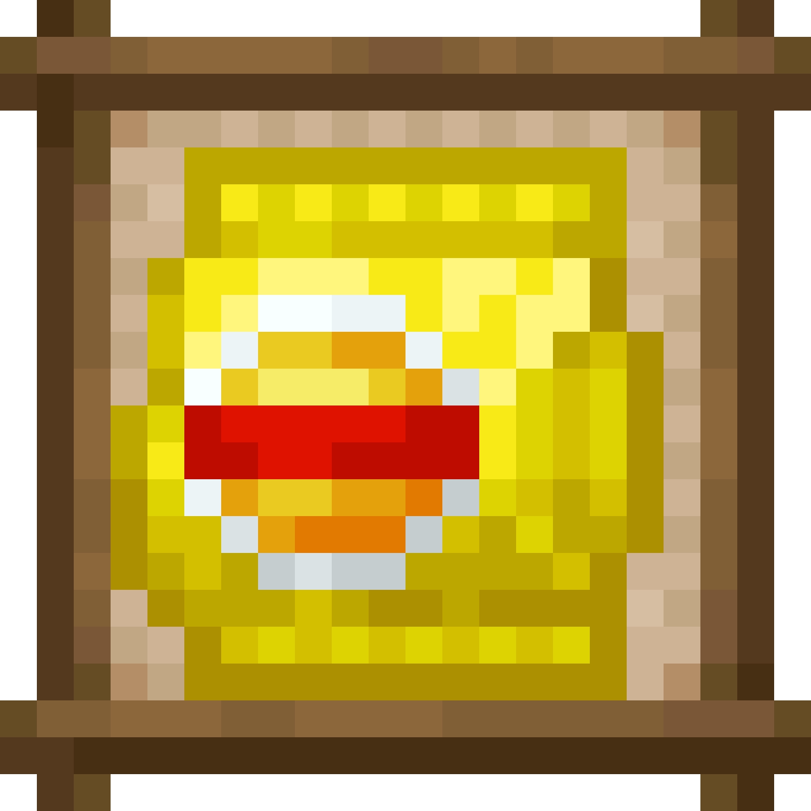
  <h1>SyalsDelight-CE</h1>
  <p>基于 CraftEngine 与 FarmersDelight 的 Paper/Folia 服务端移植版。</p>
</div>

<p align="center">
  <a href="#环境与安装"></a>
  <a href="https://github.com/Xiao-MoMi/craft-engine"></a>
  <a href="https://github.com/IOVEYOUMC0/Farmersdelight-Plugin"></a>
  <a href="#环境与安装"></a>
  <a href="#环境与安装"></a>
  <a href="#环境与安装"></a>
</p>

## 项目介绍

SyalsDelight 是将 [syals-delight](https://github.com/y271727uy/syals-delight) 的主要玩法移植为由 CraftEngine 驱动的 Paper/Folia 服务端插件，是 [FarmersDelight](https://github.com/IOVEYOUMC0/Farmersdelight-Plugin) 的附属插件，包含自定义食物、马铃薯处理链、风味薯片、油瓶、动物脂肪掉落、削皮刀，以及公共烹饪锅和砧板配方页。

移植基线为上游 `main` 分支提交模组版本`1.20.1-1.0.2`。

## 已实现

- 上游源码实际注册的全部 30 个物品。
- 22 种可食用物品，以及从马铃薯到成品薯片的完整制作流程。
- 三个使用玻璃瓶作为合成剩余物的油瓶。
- 9 个公共烹饪锅配方、2 个公共砧板配方和 18 个 CraftEngine 工作台配方。
- 通过 `EntityDeathEvent` 实现的七种动物脂肪额外掉落。

## 物品与获取方式

| 物品 | 获取方式 | 物品 | 获取方式 |
|---|---|---|---|
| <br><small>事乐薯片</small> | 工作台无序合成：4 个批量薯片 + 事乐包装袋 | <br><small>袋装薯片</small> | 工作台无序合成：4 个油腻薯片 + 薯片包装袋 |
| <br><small>手工薯片</small> | 工作台无序合成：4 个热薯片 + 薯片包装袋 | <br><small>硅岩薯片</small> | 工作台无序合成：4 个炸硅岩薯片 + 薯片包装袋 |
| 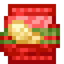<br><small>湾鲑牌减脂薯片</small> | 工作台无序合成：4 个低脂薯片 + 生鲑鱼 + 包装袋 | <br><small>醋味薯片</small> | 工作台无序合成：原版醋物品，或替代蜂蜜瓶 + 4 个炸薯片 |
| 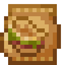<br><small>驴肉火烧味薯片</small> | 工作台无序合成：原版驴肉火烧，或替代熟牛肉 + 4 个炸薯片 | 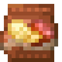<br><small>烟熏火腿风味薯片</small> | 工作台无序合成：FarmersDelight 烟熏火腿 + 4 个炸薯片 |
| 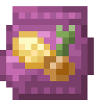<br><small>洋葱味薯片</small> | 工作台无序合成：FarmersDelight 洋葱 + 4 个炸薯片 | 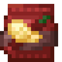<br><small>香辣味薯片</small> | 工作台无序合成：2 个烈焰粉 + 4 个炸薯片 |
| 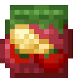<br><small>番茄味薯片</small> | 工作台无序合成：FarmersDelight 番茄 + 4 个炸薯片 | 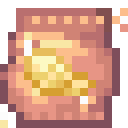<br><small>星辰薯片</small> | 工作台无序合成：原版星尘，或替代紫水晶碎片 + 4 个炸薯片 |
| <br><small>西兰花减脂薯片</small> | 工作台无序合成：FarmersDelight 卷心菜 + 4 个低脂薯片 | <br><small>青酱味薯片</small> | 工作台无序合成：FarmersDelight 番茄酱 + 4 个炸薯片 |
| 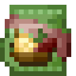<br><small>青酱烤肉味薯片</small> | 工作台无序合成：番茄酱 + 熟牛肉 + 4 个炸薯片 | 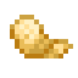<br><small>批量下锅的薯片</small> | 烹饪锅：4 个土豆片 + 2 个食用油 |
| 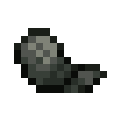<br><small>炸硅岩薯片</small> | 烹饪锅：土豆片、食用油和替代晶体 | 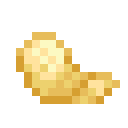<br><small>炸薯片</small> | 烹饪锅：2 个土豆片 + 2 个食用油 |
| 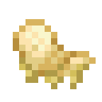<br><small>油腻的薯片</small> | 烹饪锅：2 个土豆片 + 3 个食用油 | 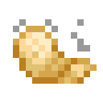<br><small>热薯片</small> | 烹饪锅：2 个炸薯片 + 2 个食用油 |
| 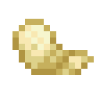<br><small>低脂薯片</small> | 烹饪锅：2 个土豆片 + 1 个食用油 | <br><small>土豆片</small> | 砧板：去皮马铃薯 + FarmersDelight 小刀 |
| 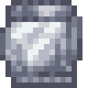<br><small>薯片包装袋</small> | 工作台有序合成：4 张纸 | <br><small>事乐薯片包装袋</small> | 工作台无序合成：包装袋 + 黄色染料 + 红色染料 |
| <br><small>去皮马铃薯</small> | 砧板：马铃薯 + 精确 `syals_delight:peeler` | <br><small>动物脂肪</small> | 牛、猪、羊、鸡、兔、山羊或哞菇死亡 |
| 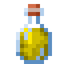<br><small>油瓶</small> | 烹饪锅：2 个动物脂肪 | 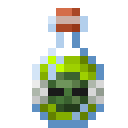<br><small>僵尸油瓶</small> | 烹饪锅替代配方：2 个腐肉 |
| 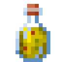<br><small>地沟油瓶</small> | 烹饪锅替代配方：2 个煤炭 | <br><small>削皮刀</small> | 工作台有序合成：铁锭 + 木棍 |

## 食物数值

1.20.1 Forge 的 `FoodProperties` 使用饱和度修正值，而 CraftEngine
使用绝对饱和度。本项目采用以下换算：

```text
CraftEngine 绝对饱和度 = 饥饿值 × 源码 saturationModifier × 2
```

| 分类 | 饥饿值 | 源码修正值 | CraftEngine 饱和度 |
|---|---:|---:|---:|
| 普通薯片 | 6 | 9.3 | 111.6 |
| 减脂薯片 | 4 | 8.6 | 68.8 |
| 醋味薯片 | 6 | 9.9 | 118.8 |
| 硅岩薯片 | 189 | 66.4 | 25099.2 |
| 薯片半成品 | 2 | 2.0 | 8.0 |

源码没有为任何食物注册药水效果，因此本项目没有添加不存在的效果。

## 削皮刀

上游削皮刀使用石级剑，构造参数攻击伤害为 3、攻击速度为 -2.4。石级还会提供
1 点属性伤害，因此效果与石剑的最终 5 点伤害一致。本项目保留该最终伤害、
131 点耐久和攻击速度。削皮刀没有加入 FarmersDelight 小刀标签；只有
`minecraft:potato -> peeled_potato` 砧板配方接受精确的削皮刀 ID。

## 配方与标签

上游共有 37 个配方 JSON，其中 17 个引用可选模组命名空间，因此不会直接注册。
项目以 10 个独立 fallback 配方补回获取路线。运行包包含：

| 工作站 | 数量 | 分类 |
|---|---:|---|
| FarmersDelight 烹饪锅 | 9 | 公共 `cooking_pot` |
| FarmersDelight 砧板 | 2 | 公共 `cutting_board` |
| CraftEngine 工作台 | 18 | CraftEngine 配方书 |

项目没有创建私有 RecipeType。切土豆片使用
`#farmersdelight:tools/knives`；`syals_delight:food_oil` 只包含三个油瓶。

## 动物脂肪掉落

原模组为牛、猪、羊、鸡、兔、山羊和哞菇的死亡战利品追加 1 个动物脂肪，
没有概率判断。本项目默认保持 100% 概率和数量 1；`config.yml`
可以修改概率、数量和实体列表。

掉落同步加入区域线程上的 `EntityDeathEvent`，因此兼容 Folia。插件只接受
精确 ID `syals_delight:animal_fat`；若 CraftEngine 返回 AIR、BARRIER
或其他自定义 ID，则取消本次额外掉落。

## 目前没有兼容的项目

目前没有针对源码可选模组命名空间的兼容项目。依赖这些物品的原配方不会注册，
统一使用 fallback 配方保证附属物品仍可获取。

| 命名空间 | 源码物品 | 用途 |
|---|---|---|
| `gtceu` | 5 种硅岩粉 | 炸硅岩薯片 |
| `mekanism_extras` | `dust_naquadah` | 炸硅岩薯片 |
| `ltc2` | `solid_underground_oil` | 地沟油瓶 |
| `unusualfoodsdelight` | `zombie_oil_block` | 僵尸油瓶 |
| `vintagedelight` | `vinegar_bottle` | 醋味薯片 |
| `manors_bounty` | `rice_vinegar` | 醋味薯片 |
| `dumplings_delight` | `vinegar` | 醋味薯片 |
| `smc` | `star_dust`、`broccoli` | 星辰薯片、西兰花薯片 |
| `kaleidoscope_cookery` | `donkey_burger`、`oil` | 驴肉火烧薯片、动物脂肪制油 |
| `cosmopolitan` | `green_sauce` | 青酱味薯片、青酱烤肉薯片 |

获取分类：

- 只需 Minecraft、CraftEngine 和 FarmersDelight 即可直接获得：30 个附属物品。
- 需要使用额外兼容提供物的原配方：炸硅岩薯片、地沟油、僵尸油、醋味薯片、
  星辰薯片、西兰花薯片、驴肉火烧薯片、青酱薯片和青酱烤肉薯片。
- 当前无法作为原外部物品获得：上表 16 个 ID。

fallback 配方位于 `configuration/compatibility_fallback_recipes.yml` 和
`configuration/farmersdelight/compatibility_fallback_recipes.yml`，
不会把未知命名空间写入运行中的 CraftEngine 配方。


## 环境与安装

1. 安装 Java 21，以及 Paper 26.3 或 Folia 26.3。
2. 安装 CraftEngine 26.9.1 或更新版本。
3. 安装 FarmersDelight-Plugin 1.0.3。
4. 将 `SyalsDelight-1.0.0.jar` 放入 `plugins/`。
5. 完整停止并重新启动服务器。

首次启动会安装 `plugins/CraftEngine/resources/syals_delight`，并写入
`.syals-delight-resources-version`。普通重启只补缺失文件；插件版本变化时
替换本附属命名空间并删除新版本不再包含的旧文件。外部 `config.yml`、
`gui.yml` 和 `lang/*.yml` 不会被已有用户修改覆盖。

## 配置

`config.yml` 控制玩家消息语言、资源修复、版本替换、动物脂肪开关/概率/数量/
实体列表，以及 FarmersDelight 完成预热后的可选物品检查。

`gui.yml` 只记录使用 FarmersDelight 公共配方页的配置。本附属没有私有工作站 GUI。


## 许可

上游 Syal's Delight 模组采用 MIT 许可，本 SyalsDelight Paper/Folia 插件采用
GNU Affero 通用公共许可证第 3 版（AGPL-3.0-only）。

## 赞助与支持

如果本项目对你有帮助，可以通过 Ko-fi 或爱发电赞助开发。赞助后可提供插件安装、配置与故障排查等问答服务。

<div align="center">
  <a href="https://ko-fi.com/J5C529ZWWL" target="_blank"></a>
  <a href="https://afdian.com/a/sss000" target="_blank"></a>
</div>

